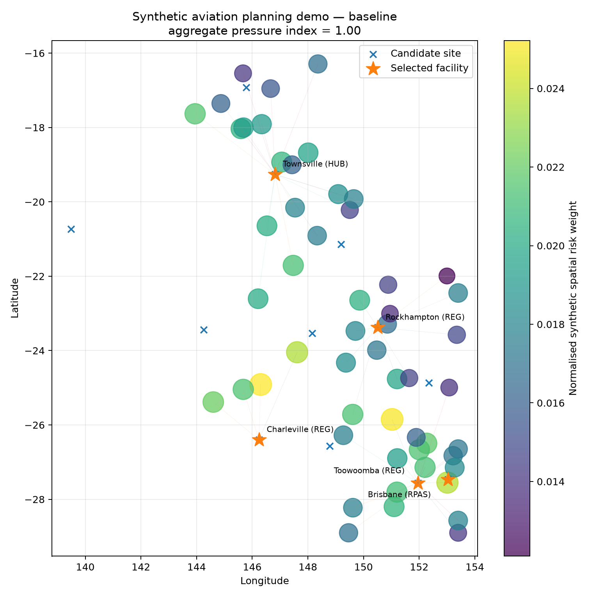
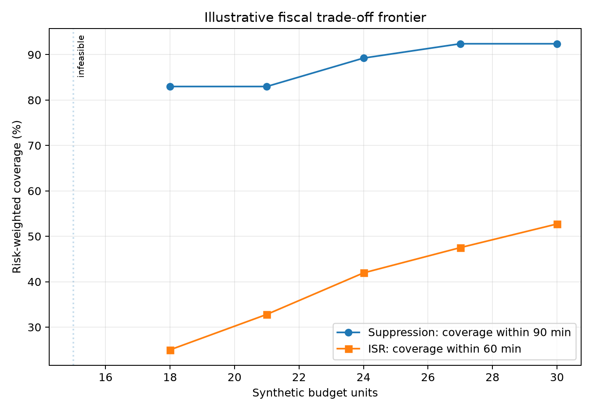

# QFD Aviation Decision Lab

A compact, reproducible **synthetic decision-support prototype** inspired by APR.Intern **APR-3040**: *Optimising the type and location of aviation hubs and airbases to deliver efficient and effective aviation services*.

The project demonstrates how a risk-based aviation infrastructure planning workflow can combine spatial hazard, climate exposure, vulnerability, water scarcity and fiscal constraints; represent multiple facility classes; distinguish crewed suppression from ISR/RPAS service; optimise location and type; export GIS-ready layers; and stress-test a network across future-risk scenarios.

> **Portfolio demonstration only.** No Queensland Fire Department operational data are used. Candidate sites, costs, speeds, ranges, readiness times, mission weights and risk values are synthetic placeholders. No output is an operational recommendation.

## Why this prototype exists

APR-3040 asks for a replicable, risk-based framework to support strategic planning around aviation hubs, airbases, mobile facilities, crewed aircraft and Remotely Piloted Aircraft Systems (RPAS). The advertised project specifically calls for integration of bushfire/climate risk, vulnerability, water availability and fiscal considerations, with spatial analysis, maps and a practical decision-support tool.

This repository implements a deliberately small end-to-end version of that analytical pattern to demonstrate capability in:

- geospatial and risk modelling;
- heterogeneous-data integration;
- mathematical optimisation;
- crewed-versus-RPAS capability modelling;
- scenario and fiscal sensitivity analysis;
- interpretable decision metrics;
- GIS-ready data products;
- reproducible Python research software.

## Public operational context used to shape the software design

The architecture is informed by public QFD material, but **none of the public descriptions below are used as numerical model inputs**.

- QFD's public aerial-assets page distinguishes water-bombing, intelligence/reconnaissance/surveillance (ISR), air observation and RPAS roles. It also notes that some fixed-wing water-bombing operations depend on airbase refilling/refuelling and that turnaround depends on distance between the incident and the airbase:  
  https://www.fire.qld.gov.au/about-us/frontline-services/fire-and-rescue-service/aerial-assets
- QFD's 2024–25 Annual Report describes RPAS as an expanding operational capability used for situational awareness and other emergency-response tasks:  
  https://www.fire.qld.gov.au/sites/default/files/2025-09/QFD-Annual-Report-2024-25.pdf
- APR.Intern APR-3040 project description:  
  https://aprintern.org.au/internship/queensland-fire-department-apr-3040/

## Prototype workflow

```text
synthetic Queensland-inspired spatial cells
                  |
                  v
 hazard + climate + vulnerability + water scarcity
                  |
                  v
      scenario pressure + spatial risk weights
                  |
        +---------+----------+
        |                    |
        v                    v
 candidate sites       facility classes
                       HUB / REG / MOB / RPAS
        |                    |
        +---------+----------+
                  v
        multi-mission MILP optimiser
      budget + range + one type/site
                  |
        +---------+----------+
        |                    |
        v                    v
 crewed suppression      ISR / RPAS
 assignments             assignments
        |                    |
        +---------+----------+
                  v
 response / coverage / resilience metrics
                  |
                  v
 CSV + JSON + GeoJSON + maps + decision brief
```

## Facility-type schema

The demo uses four **illustrative software classes**:

| Code | Prototype class | Suppression | ISR | Planning role |
|---|---|---:|---:|---|
| `HUB` | Strategic aviation hub | yes | yes | High-capability multi-mission support |
| `REG` | Regional airbase | yes | yes | Regional crewed response with ISR capability |
| `MOB` | Mobile staging base | yes | no | Lower-cost deployable suppression capability |
| `RPAS` | RPAS / local ISR node | no | yes | Low-cost local intelligence capability |

These classes show how a standardised classification could be represented computationally. They are **not claimed to reproduce an existing QFD or national classification**.

All class performance and cost parameters are explicitly synthetic. Their purpose is to exercise the optimisation logic, not to estimate real aircraft performance or infrastructure cost.

## Two mission types

Version 0.2 separates two planning services instead of treating every aviation asset as interchangeable:

1. **suppression** — an illustrative crewed response mission affected by distance, readiness and water-related turnaround friction;
2. **ISR** — an illustrative intelligence/surveillance mission that can be provided by multi-mission facilities or dedicated RPAS nodes.

The default objective weights are:

```text
suppression  60%
ISR          40%
```

These are configurable software assumptions, **not QFD priorities or policy weights**.

## Risk formulation

A key design choice in v0.2 is separating **aggregate scenario pressure** from **spatial risk allocation**.

For each scenario, the synthetic risk components are combined into a raw pressure surface. The pipeline then stores:

- `scenario_pressure_index` — total raw pressure relative to baseline;
- `scenario_risk` — the same surface normalised to sum to one, used as spatial optimisation weights.

This prevents a statewide increase in synthetic pressure from being confused with a change in where risk is concentrated.

## Optimisation model

For synthetic risk cells `i`, candidate site/type options `o`, and mission types `m`, the mixed-integer solver minimises approximately:

```text
sum_m mission_weight_m * sum_i,o spatial_risk_i * response_time_i,o,m * assignment_i,o,m
+ small fixed-cost regularisation
```

subject to:

- each risk cell receiving one feasible assignment for each mission;
- mission-specific range and capability constraints;
- assignments only using selected facilities;
- at most one facility type at each candidate location;
- a configurable fiscal budget;
- a cap on the number of selected locations.

The implementation uses SciPy's mixed-integer linear optimiser.

## Scenario stress tests

The framework is re-run for:

1. `baseline`;
2. `severe_drought`;
3. `extreme_fire_weather`;
4. `future_stress_test`.

The scenario layer changes synthetic hazard, climate and/or water-scarcity pressure. The output reports both the aggregate pressure index and service-performance changes.

The pipeline also compares each selected network to the baseline configuration and reports whether the site/type mix changes. A stable configuration under stress is treated as a robustness result, not hidden as a non-result.

## Fiscal sensitivity and infeasibility

The baseline network is re-optimised across several synthetic budgets.

If a budget is too small to satisfy both suppression and ISR coverage requirements, the pipeline records that point as **infeasible** instead of crashing or silently relaxing requirements. This makes the budget frontier useful for exposing minimum-capability thresholds as well as marginal service improvements.

## GIS-ready outputs

The prototype writes standards-based GeoJSON with WGS84 longitude/latitude coordinates and no GIS-specific Python dependency.

Important layers include:

- `outputs/candidate_sites.geojson`
- `outputs/risk_cells_baseline.geojson`
- `outputs/selected_network_baseline.geojson`
- `outputs/assignment_lines_baseline.geojson`

Equivalent risk, selected-network and assignment-line layers are generated for every scenario. They can be opened directly in QGIS or other GeoJSON-capable GIS tools.

## Quick start

```bash
conda create -n qfd-aviation python=3.12 -y
conda activate qfd-aviation
python -m pip install -e ".[dev]"
bash scripts/local_check.sh
```

Or run the demo directly:

```bash
qfd-aviation-demo --output-dir outputs --budget 24
```

## Headline demonstration outputs

These figures are generated by the deterministic synthetic demonstration and are
**software-validation outputs, not operational recommendations to QFD**.

### Reference-budget multi-mission network



The reference run demonstrates joint selection of crewed suppression infrastructure
and an RPAS/ISR node under a synthetic fiscal constraint.

### Budget-versus-service frontier



The fiscal sweep exposes feasibility thresholds and trade-offs between suppression
and ISR service as the synthetic budget changes.

## Important generated products

| Output | Purpose |
|---|---|
| `scenario_summary.csv/json` | Pressure, configuration and mission-level scenario metrics |
| `budget_sensitivity.csv` | Fiscal feasibility and service trade-offs |
| `budget_frontier.png` | Suppression and ISR coverage versus budget |
| `facility_type_catalog.csv` | Inspectable facility/capability assumptions |
| `selected_networks.csv` | Selected site/type configurations |
| `assignments.csv` | Cell-to-facility assignments for both missions |
| `decision_brief.md` | Stakeholder-facing interpretation |
| `network_*.png` | Scenario maps |
| `*.geojson` | GIS-ready risk, network and assignment layers |

## Repository map

```text
src/qfd_aviation_lab/
  data.py          deterministic synthetic spatial data
  domain.py        facility classes + mission capability assumptions
  geo.py           great-circle spatial distances
  geojson.py       dependency-light GIS exports
  scenarios.py     pressure + spatial-risk scenario transforms
  optimise.py      multi-mission mixed-integer facility-location model
  metrics.py       mission-specific response and coverage metrics
  report.py        maps, frontier and decision brief
  pipeline.py      end-to-end orchestration
  cli.py           command-line entry point

scripts/local_check.sh  full local lint/format/test/demo gate

tests/             deterministic, GIS and constraint-level tests
.github/workflows/ continuous integration on Python 3.11-3.13
```

## What a real QFD implementation would replace or extend

A production study would replace synthetic inputs and placeholder assumptions with stakeholder-approved data, potentially including:

- historical and forecast bushfire likelihood/severity;
- population, vulnerable communities, assets and critical infrastructure;
- QFD incident and aviation operations history;
- actual airbase, airport and mobile-facility constraints;
- aircraft/RPAS capability, availability and duty constraints;
- water-source location, reliability and turnaround effects;
- terrain, weather, airspace and routing constraints;
- simultaneous-incident and fleet-allocation modelling;
- capital and operating cost models;
- national/state facility-classification requirements;
- service-level targets agreed with QFD aviation and Hazard and Risk specialists.

The current software is deliberately structured so those approved inputs can replace the synthetic layer without changing the core optimisation/reporting workflow.

## What is not claimed

- No QFD operational, incident, aviation, infrastructure or confidential data are included.
- The synthetic risk surface is not a bushfire-risk product.
- Candidate regional centres are illustrative and are not asserted to be QFD aviation facilities.
- Synthetic cost, range, speed, readiness and mission-weight values are not budget estimates, service standards or aircraft specifications.
- The prototype facility classes are a software demonstration, not a claimed national standard.
- Synthetic performance metrics are software-validation outputs only.
- Straight-line great-circle distance is used as a transparent prototype approximation; terrain, airspace and detailed weather routing are outside scope.

## Reproducibility

The random generator is seeded and optimisation inputs are deterministic. The test suite checks:

- deterministic synthetic inputs;
- scenario-pressure / spatial-weight separation;
- budget and site-count compliance;
- mission coverage for every cell;
- assignment to selected and mission-compatible facilities;
- mission-specific range compliance;
- deterministic RPAS + crewed capability exposure in the reference run;
- objective monotonicity when the budget is relaxed;
- GeoJSON structure;
- complete end-to-end output generation.

GitHub Actions repeats linting, tests and a full demonstration run on Python 3.11, 3.12 and 3.13.

## Context

Built as a targeted research-software demonstration for the Queensland Fire Department / APR.Intern APR-3040 internship application, August 2026.
